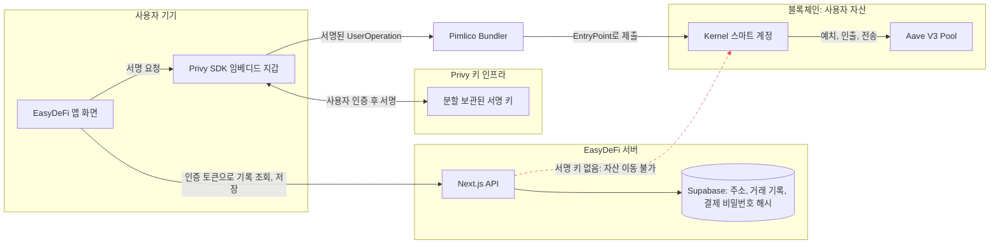
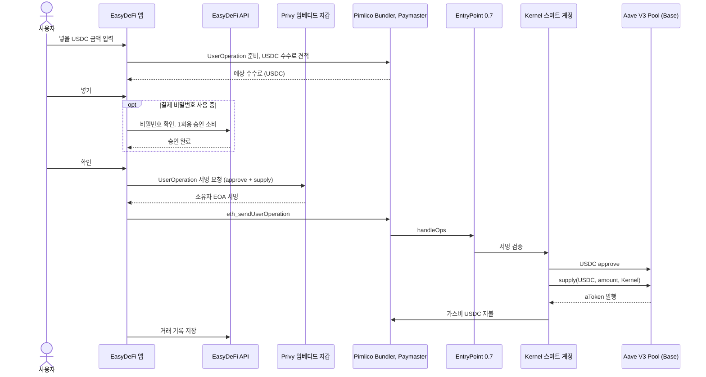
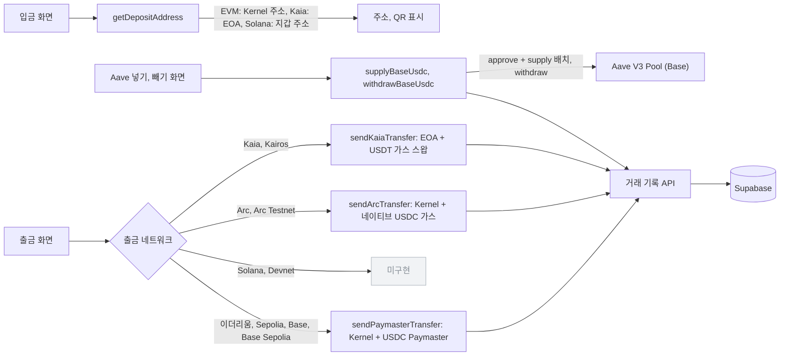
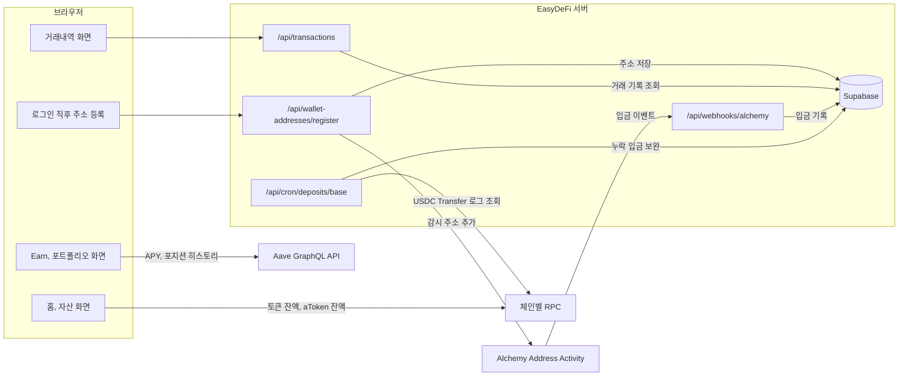

# EasyDeFi 아키텍처

현재 구현을 기준으로 한 계층별 구조다. 코드가 바뀌면 같은 PR에서 이 문서도 고친다. 결정의 이유는 [ADR](adr/README.md)에, 외부 서비스 장애 영향은 [dependencies.md](dependencies.md)에 있다.

계정 계층은 소셜 로그인(Google·이메일)으로 생성되는 Privy 임베디드 지갑을 기준으로 한다. 외부 지갑 로그인은 [외부 지갑 로그인의 한계](#외부-지갑-로그인의-한계)를 본다.

---

## 1. 비수탁 경계

EasyDeFi 서버는 사용자의 서명 키와 자산을 보관하지 않는다. ([ADR 0001](adr/0001-kernel-smart-account-owned-by-privy-eoa.md))

- **서명 키**: Privy 임베디드 지갑의 키는 Privy 키 인프라가 분할 보관하고, 사용자가 로그인한 세션에서만 서명에 쓰인다. EasyDeFi 서버와 Supabase에는 키가 없다.
- **자산**: USDC·USDT와 Aave 예치 토큰(aToken)은 블록체인 위 사용자 계정에 있다. EVM 체인(이더리움·Base·Arc)에서는 임베디드 EOA를 소유자로 둔 **Kernel 스마트 계정**이 자산을 보관하고 실행한다.
- **서버가 보관하는 것**: 입금 주소, 거래 기록, 결제 비밀번호 해시(scrypt)뿐이다. 서버는 이 정보로 사용자 자산을 옮길 수 없다.
- **결제 비밀번호**: 넣기·빼기·출금 전에 서버가 확인하는 화면 잠금이다. 60초 동안 한 번만 쓸 수 있는 승인(grant)을 발급하지만, 서명 권한은 아니다. ([ADR 0003](adr/0003-server-checked-payment-pin.md))
- **예외**: Kaia는 Kernel 없이 임베디드 EOA로 직접 전송하고, Solana는 Privy Solana 지갑 주소를 그대로 쓴다. 두 경우 모두 키는 Privy에 있고 서버에는 없다.

---

## 2. 계정, 실행, 가스 계층

### 계정

| 구성 | 구현 |
|---|---|
| 로그인 | Privy `loginMethods`: Google, 이메일, 외부 지갑(SIWE) |
| 서명자 | 로그인 시 생성되는 Privy 임베디드 EOA (`createOnLogin: users-without-wallets`) |
| 스마트 계정 | permissionless `toKernelSmartAccount`, Kernel 0.3.3, index 0, EntryPoint 0.7 |
| 주소 | 임베디드 EOA에서 Kernel 주소를 계산해 이더리움·Sepolia·Base·Base Sepolia·Arc·Arc Testnet 입금 주소로 사용 (`lib/deposit/kernel-address.ts`) |

### 실행과 가스

([ADR 0002](adr/0002-pimlico-bundler-and-erc20-paymaster.md))

| 네트워크 | 실행 계정 | 번들러 | 가스 지불 |
|---|---|---|---|
| 이더리움, Sepolia, Base, Base Sepolia | Kernel | Pimlico | Pimlico ERC-20 Paymaster, USDC로 지불 (`lib/paymaster/fee-client.ts`) |
| Arc, Arc Testnet | Kernel | Pimlico | Paymaster 없음, Arc 네이티브 USDC 가스 (`lib/withdraw/arc-fee-client.ts`) |
| Kaia, Kairos | 임베디드 EOA | 없음 | USDT 일부를 Kaia 가스 스왑 라우터로 KAIA로 바꿔 지불 (`lib/withdraw/send-kaia-transfer.ts`) |

### UserOperation 배치: Aave 넣기 (Base USDC)

`lib/aave/supply-base-usdc.ts`의 `supplyBaseUsdc`는 `approve`와 `supply` 두 호출을 **하나의 UserOperation**으로 묶어 보낸다. 사용자는 한 번만 서명하고, 가스는 같은 계정의 USDC로 Paymaster가 정산한다. Paymaster에 대한 USDC 허용량이 부족하면 `prepareUserOperationForErc20Paymaster`가 Paymaster `approve` 호출을 배치 맨 앞에 자동으로 추가한다. 빼기(`withdrawBaseUsdc`)와 출금 전송은 호출이 하나인 UserOperation이다.

1. 금액을 입력하면 `quoteSupplyBaseUsdcFee`가 `prepareUserOperation`과 `estimateErc20PaymasterCost`로 USDC 수수료를 미리 보여준다.
2. 넣기를 누르면 결제 비밀번호가 켜진 경우 `/api/payment-pin/verify`와 `/consume`으로 1회용 승인을 받는다.
3. 확인 모달에서 확인하면 `smartAccountClient.sendTransaction({ calls: [approve, supply], paymasterContext: { token: USDC } })`를 호출한다.
4. Privy 임베디드 EOA가 UserOperation 해시에 서명하고, Pimlico Bundler가 EntryPoint 0.7에 제출한다.
5. Kernel이 서명을 검증한 뒤 USDC `approve(AavePool, amount)`와 `supply(USDC, amount, Kernel, 0)`를 차례로 실행한다. Paymaster는 Kernel에서 USDC로 가스비를 받는다.
6. 영수증에서 발행된 aToken 수량을 읽고 `/api/transactions/aave`에 기록한다.

### 외부 지갑 로그인의 한계

MetaMask·Phantom 로그인은 SIWE로 인증까지만 지원하고, 가스리스 UX는 보류했다. ([ADR 0004](adr/0004-defer-eip7702-for-external-wallets.md))

- 외부 지갑 사용자에게 가스리스 UX(배치 실행, USDC 가스 지불)를 주려면 외부 지갑 EOA를 EIP-7702로 Kernel에 위임해야 한다.
- 그러나 MetaMask, Phantom, Coinbase Wallet은 dApp이 임의의 위임 대상에 대한 7702 authorization 서명을 요청하는 기능을 열어 두지 않았다. 따라서 앱에서 외부 지갑을 Kernel로 위임할 수 없어 가스리스 UX를 제공할 수 없다.
- 이 지갑들이 7702 서명 기능을 열 때까지 외부 지갑의 가스리스 UX는 보류한다. 그동안 넣기·빼기와 USDC 가스 출금은 Privy 임베디드 지갑 사용자에게만 적용된다.

---

## 3. 앱 로직과 프로토콜 연동

### 3-1. 실행 흐름: 입금, 출금, Aave

- **입금**: 앱은 돈을 받는 쪽이라 실행이 없다. `getDepositAddress`가 네트워크별 주소를 고른다. EVM 체인은 Kernel 주소, Kaia는 임베디드 EOA, Solana는 Privy Solana 지갑 주소다.
- **출금**: `WithdrawFlow`가 네트워크별로 전송 함수를 나눈다. Solana 출금은 아직 구현하지 않았다.
- **Aave**: Base 메인넷 USDC 리저브 한 곳만 연동한다. 넣기는 approve+supply 배치, 빼기는 `withdraw` 단일 호출이다.
- 모든 실행 결과는 `/api/transactions/withdraw` 또는 `/api/transactions/aave`로 기록된다. 기록에 실패하면 `RetryPendingActivities`가 다시 시도한다.

| 토큰 | 입금·출금 네트워크 |
|---|---|
| USDC | 이더리움, Base, Arc, Solana, Sepolia, Base Sepolia, Arc Testnet, Solana Devnet |
| USDT | 이더리움, Kaia, Kairos |

### 3-2. 조회와 기록 흐름: 자산, 거래내역

- **자산 잔액**: 서버를 거치지 않고 브라우저에서 체인별 RPC를 직접 호출한다. 토큰 잔액은 `lib/withdraw/token-balance.ts`, Aave 예치 잔액은 aToken `balanceOf`(`getBaseUsdcWithdrawable`)로 읽는다.
- **APY와 포지션 히스토리**: Aave GraphQL API(`api.v3.aave.com`)에서 가져온다 (`lib/aave/base-usdc-supply-apy.ts`, `lib/aave/base-usdc-reserve.ts`, `lib/portfolio/position-history.ts`).
- **지갑 등록**: 로그인 직후 `RegisterWalletAddresses`가 `/api/wallet-addresses/register`를 호출한다. 서버는 Privy 토큰을 검증하고 주소를 Supabase `wallet_addresses`에 저장한 뒤 Alchemy 웹훅 감시 주소에 추가한다.
- **입금 기록**: Alchemy Address Activity 웹훅(`/api/webhooks/alchemy/address-activity`)이 실시간으로 기록하고, `/api/cron/deposits/base`가 Base RPC의 USDC Transfer 로그로 누락분을 보완한다. ([ADR 0005](adr/0005-deposit-detection-webhook-and-cron.md))
- **거래내역**: `/api/transactions`와 `/api/transactions/[id]`가 Privy 토큰을 검증한 뒤 Supabase `activities`를 읽는다. 해시는 블록 탐색기 링크로 보여준다.

